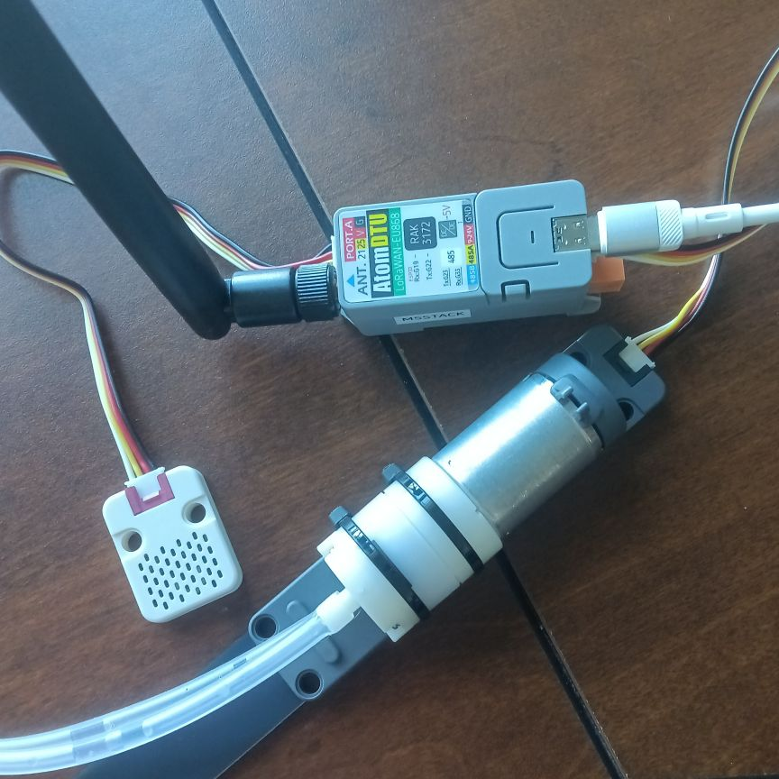

# LMAO — LoRa Mesh Communication POC

**Proof of Concept**: Bidirectional LoRa communication between a Raspberry Pi
server and an M5Stack Cardputer ADV client using the
[Reticulum](https://reticulum.network/) networking stack with
[LXMF](https://github.com/markqvist/LXMF) messaging.

---

## Architecture

```
┌─────────────────────────────────────────────────────────────────────┐
│                        LoRa RF (868/915 MHz)                        │
│  ┌───────────────┐                          ┌──────────────────────┐│
│  │ Laptop/Desktop│                          │ M5Stack Cardputer    ││
│  │ Human Client  │  WiFi/AutoIface          │ ADV                  ││
│  │ (Python CLI)  │──┐                       │ ┌────────────────┐   ││
│  └───────────────┘  │                       │ │ µReticulum     │   ││
│                     │                       │ │ client         │   ││
│  ┌──────────────────┴────────────────────┐  │ └──────┬─────────┘   ││
│  │  K8s Cluster (Turing Pi 2)            │  │        │ SPI          ││
│  │                                      │  │ ┌──────┴─────────┐   ││
│  │  ┌────────────────────────┐          │  │ │ SX1262 LoRa    │   ││
│  │  │ lmao-server Deployment │          │  │ │ radio + ant    │   ││
│  │  │ (tp4, hostNetwork)     │◄──LoRa───┼──┼─┘                │   ││
│  │  │ RNS+LXMF+gRPC+NATS pub │    ▲     │  └──────────────────────┘│
│  │  └───────────┬────────────┘    │ USB │                          │
│  │              │          ┌──────┴───┐ │                          │
│  │              │          │ESP32     │ │                          │
│  │              │          │RNode     │ │                          │
│  │              │          │(tp4 USB) │ │                          │
│  │              │          └──────────┘ │                          │
│  │  ┌───────────┴─────────┐            │                          │
│  │  │ NATS JetStream      │            │                          │
│  │  │ lmao.messages.env   │            │                          │
│  │  └───────────┬─────────┘            │                          │
│  │  ┌───────────┴─────────┐            │                          │
│  │  │ IoT Ingest Pod      │            │                          │
│  │  │ (NATS → DuckDB)     │            │                          │
│  │  └─────────────────────┘            │                          │
│  └─────────────────────────────────────┘                          │
└─────────────────────────────────────────────────────────────────────┘
```

## Quickstart

### Prerequisites

| Component | Requirements |
|-----------|-------------|
| Raspberry Pi | Python 3.8+, USB port |
| ESP32 RNode | Flashed with RNode firmware |
| Cardputer ADV | M5Stack Cardputer with LoRa antenna, MicroPython installed |
| Laptop/Desktop | Python 3.8+, optional RNode USB for LoRa |
| LoRa band | Matching frequency (868 MHz EU / 915 MHz US) |
| Bazel | v7.4.1 (see `.bazelversion`) — use [bazelisk](https://github.com/bazelbuild/bazelisk) (auto-selects correct version via `.bazelversion`). Install: `npm install -g @bazel/bazelisk` ([other install methods](https://github.com/bazelbuild/bazelisk#installation)). Ensure `~/.npm-global/bin` (or your npm global bin dir) is in `PATH`. Verify with `bazel --version` (expected: `bazel 7.4.1`). |
| Docker | For containerized deployment (optional) — `docker --version` |
| kubectl | For K8s Service deployment (optional) — `kubectl version --client` |

### 1. Flash the ESP32 RNode

Follow the guide in [`rnode_firmware/README.md`](rnode_firmware/README.md).

After flashing, verify:

```bash
rnodeconf --port /dev/ttyUSB0 --info
```

### 2. Build & Install Server Dependencies

The canonical build system is [Bazel](https://bazel.build/) (see `.bazelversion` for the
required version). Bazel generates protobuf stubs, resolves Python dependencies, and runs tests.

**Option A — Bazel (recommended):**

```bash
# Build everything (generates protobuf stubs, installs deps)
bazel build //lmao_server:server

# Run the server
bazel run //lmao_server:server
```

**Option B — pip (no Bazel):**

If you prefer to run without Bazel, you must first generate the protobuf stubs manually,
then install dependencies with pip:

```bash
# Generate protobuf Python stubs (required by lma_core)
protoc --python_out=. --grpc_python_out=. proto/lma_messages.proto proto/lma_grpc.proto
# The generated files will be at proto/lma_messages_pb2.py, proto/lma_messages_pb2_grpc.py,
# proto/lma_grpc_pb2.py and proto/lma_grpc_pb2_grpc.py

# Install Python dependencies
cd lmao_server && pip3 install -r requirements.txt

# Run from repo root with PYTHONPATH including both lmao_server/ (for config) and repo root
cd .. && PYTHONPATH="$PWD/lmao_server:$PWD" python3 lmao_server/server.py
```

### 3. Configure the Server

The RNode port is auto-detected from common ports (`/dev/ttyUSB0`, `/dev/ttyACM0`, etc.).
Override with the `LMAO_RNODE_PORT` environment variable:

```bash
# Auto-detect (default)
python3 server.py

# Or specify the port explicitly
LMAO_RNODE_PORT=/dev/ttyACM0 python3 server.py
```

If no RNode is connected, the server starts in WiFi-only mode with a warning.

Edit `lmao_server/config.py` to adjust radio parameters:
- Set `frequency` for your region (868 MHz EU / 915 MHz US)
- Set `spreadingfactor`, `bandwidth`, `txpower` — **must match the client**

> **Note:** The optional `nats-py` package is required for NATS JetStream
> queue features. Install with `pip install nats-py`.

### 4. Start the Server

```bash
# Using Bazel (recommended)
bazel run //lmao_server:server

# Or without Bazel (from repo root, with PYTHONPATH including lmao_server/)
PYTHONPATH="$PWD/lmao_server:$PWD" python3 lmao_server/server.py
```

Expected output (same for both methods):

```
Initializing Reticulum...
Reticulum initialized.
Starting LXMF router...

==================================================
LMAO Server POC — Running
Node identity: 1a2b3c4d5e6f...
Listening for LXMF messages...
  LoRa: RNode on /dev/ttyUSB0
  Title discriminator: p:Envelope
==================================================
```

### 5. Configure and Flash the Cardputer

The Cardputer runs the **MicroPython client** (`cardputer_client/*.py`,
µReticulum + the micropython-lib `lora-sx126x` driver). That library stack is
the maintained, field-proven path for this board (including the
chart/display), and `install_all` flashes it by default. It serves the LMAO
wire contract: an LXMF `SensorReport` (die temp, optional DHT20 humidity) to
the server's `lxmf.delivery` destination, discovered from the server's
announce, and decodes the server's `ACK` + `DATA` reply for the on-screen
chart.

The **native C firmware** (`cardputer_client/firmware/`, ESP-IDF +
RTReticulum) is **opt-in** — `bazel run //tools:install_all -- --native-cardputer`.
It is reserved for hardware with a very tight heap, where MicroPython does not
fit; the **Sprout / Atom Lite** native client
(`smart_irrigation/native-client`) is its primary user. Both native trees
share a **single canonical protocol component**
in `firmware_common/` (DRY — no per-tree copies): `lma_common` holds the
`lma_encoder`/`lxmf_send`/`lma_chart`/`path_find`/`lma_identity` sources,
`rtreticulum/` holds the RNS wrapper and `tcp_interface/` the Reticulum
`TCPClientInterface` (one source that compiles on POSIX hosts and under
ESP-IDF, so the host interop harness and the board firmwares share it); each
`build.sh` stages it into the targeted
`.rtreticulum/firmware/<name>/components/`. Add cross-device code
there, never in a device `main/` (see AGENTS.md "DRY").

**One-off: install M5Stack MicroPython (needed before the first client flash)**

`install_all` copies the client over the raw REPL, so the device must already be
running M5Stack MicroPython (UIFlow2). Per M5Stack that image is normally burnt
with M5Burner; the equivalent headless route is the official release build
(Cardputer **Adv** = `esp32s3-8mb-cardputeradv`):

```bash
curl -LO https://github.com/m5stack/uiflow-micropython/releases/download/2.5.2/\
uiflow-587e134-esp32s3-8mb-cardputeradv-v2.5.2-20260831.bin
esptool.py --chip esp32s3 --port /dev/ttyACM0 --baud 1500000 \
  write_flash -z 0x0 uiflow-587e134-esp32s3-8mb-cardputeradv-v2.5.2-20260831.bin
```

(This is the one sanctioned esptool step for this board and it erases the
device — including any previously stored identity, which must then be
re-allow-listed; a wedged USB-Serial-JTAG needs a physical unplug/replug.)

**Heap note — the client ships as `.mpy` on UIFlow2.** The urns stack does not
fit that firmware's ~177 KB GC heap as `.py` sources: importing them compiles
bytecode into RAM, and the send path then dies with
`MemoryError … allocating 136 bytes` in `lxmf._find_active_link_for` (which
lazily imports `urns.link`) and reset-loops.

`install_all`/`flash.py` handle this automatically when `mpy-cross` is on
`PATH`: they compile `lib/**`, `proto/**`, `main.py`, `chart.py` and
`lora_boards.py` to `.mpy`, upload them, and **delete the `.py` counterparts —
a `.py` file shadows its `.mpy` sibling**, so the sources must go for the
bytecode to load.  `boot.py` stays source (it is the boot script) and
`config.py` stays source (`install_all` rewrites it with the DEST_HASH).

> `mpy-cross` must emit the device's bytecode ABI — UIFlow2 2.5.2 is
> MicroPython 1.27, whose ABI is mpy v6.3 (`mpy-cross --version`).  Without
> `mpy-cross` the flash falls back to `.py` sources, which is what starves the
> heap.

By hand, that is:

```bash
cd cardputer_client
find lib proto -name '*.py' | while read -r f; do mpy-cross -o "/tmp/mpyout/${f%.py}.mpy" "$f"; done
for f in main.py chart.py lora_boards.py; do mpy-cross -o "/tmp/mpyout/${f%.py}.mpy" "$f"; done
# then upload the .mpy tree over the raw REPL and delete /flash/**/*.py
```

`main.py` additionally sends opportunistically
(`desired_method=LXMessage.OPPORTUNISTIC`) and calls `gc.collect()` before each
send; the vendored `urns/lxmf.py` skips its link probe for opportunistic sends.
Without those, the send path's lazy import raises MemoryError on this heap even
when the rest of the client boots.

**Before flashing:**
- `DEST_HASH` is injected **automatically** by `bazel run //tools:install_all`:
  the tool loads/creates the server's persisted identity at
  `~/.local/share/lmao_server/lxmf/identity`, derives the `lxmf.delivery`
  destination hash, and passes it to the client — written into the
  MicroPython client's on-device config, or baked into the native firmware via
  `LMAO_DEST_HASH_HEX` at build time. Leave it unset to run announce-only.
- The client identity is **pinned — it no longer drifts across re-flashes**.
  `install_all` keeps ONE canonical client identity on the host at
  `~/.local/share/lmao_client/lxmf/identity` (**outside the repo** — private
  keys must never be committed; `lma_core/client_identity.py` knows where to
  load them) and writes it onto the device on every flash: `/flash/rns/identity`
  for the MicroPython client, and the same 64-byte private key baked into the
  native firmware as `LMAO_NODE_IDENTITY_HEX` — so both runtimes of a board
  share one delivery hash.  On the first install under this scheme an existing
  on-device identity is **adopted unchanged**, so the currently allow-listed
  hash keeps working; a wiped re-flash comes back with the *same*
  `lxmf/delivery` hash instead of minting a fresh one that would need a new
  `ALLOWED_CLIENTS` entry.  That hash is printed on the serial console and
  must be added to the server's `ALLOWED_CLIENTS` (env `LMAO_ALLOWED_CLIENTS`
  in `k8s/lmao-server.yaml`, see §5a) so the server accepts its reports.
- Report interval (default 300 s, minimum clamped 10 s), optional DHT20 sensor
  and other MicroPython-client settings live in `cardputer_client/config.py`;
  the native firmware takes them as build-time defines
  (`LMAO_INTERVAL_SECONDS`, `LMAO_SENSOR_TYPE`) — see
  `cardputer_client/firmware/build.sh`.

**Option A — MicroPython client (default):**

```bash
# Copy the client to the Cardputer and inject the server's DEST_HASH
bazel run //tools:install_all -- --skip-rnode

# Or, once M5Stack MicroPython is already on the device:
bazel run //cardputer_client:flash [-- --port /dev/ttyACM0]
```

> `--micropython-cardputer` selects this path explicitly; it is the default,
> so the flag is only needed for compatibility with existing scripts. The
> flash path copies `cardputer_client/*.py` over the raw REPL, so the device
> must already be running M5Stack MicroPython (a fresh MicroPython firmware
> install is an esptool step, outside install_all).

**Option B — Native C Cardputer firmware (opt-in):**

Reserved for hardware with a very tight heap (Sprout/Atom Lite). On the
Cardputer it has no display/receive path, so it is only needed to exercise
the native stack:

```bash
# Build the native firmware (Docker ESP-IDF) and flash it to /dev/ttyACM0
bazel run //tools:install_all -- --native-cardputer --skip-rnode

# Or drive the steps directly (no DEST_HASH — announce-only)
bazel run //cardputer_client:build_firmware
bazel run //cardputer_client:flash_firmware -- --port /dev/ttyACM0

# DEST_HASH baked at build time:
LMAO_DEST_HASH_HEX=<32-hex> LMAO_INTERVAL_SECONDS=300 bazel run //cardputer_client:build_firmware
```

> ⚠️ Always use `bazel run //tools:install_all` (not the bare
> `//cardputer_client:flash_firmware`) for any flash that must keep the
> device talking to the server — only install_all bakes the server's current
> `DEST_HASH`. The bare targets leave it unset (announce-only).

Native-firmware boot log (serial `/dev/ttyACM0`, 115200 baud):

```
Cardputer native client starting (PR1 sensor node)
identity hash: ...
my lxmf/delivery hash: ... (add to server ALLOWED_CLIENTS)
SX1262 listening on 868.0 MHz SF7 BW125
```

> Pinout presets for the MicroPython LoRa boards live in
> `cardputer_client/lora_boards.py`; the native firmware pins live in
> `cardputer_client/firmware/main/cardputer_pins.h`.

**Option C — Unified flash (install_all)**:

Flash the Cardputer runtime (MicroPython by default, `--native-cardputer` for
the C firmware) and the RNode firmware in one command.

```bash
# Auto-detect both devices and flash
bazel run //tools:install_all

# Specify explicit ports
bazel run //tools:install_all -- --cardputer-port /dev/ttyACM0 --rnode-port /dev/ttyUSB0

# Skip one device type
bazel run //tools:install_all -- --skip-cardputer
bazel run //tools:install_all -- --skip-rnode

# Also deploy Pi server and K8s services
# (internal services are released through the local Docker registry at
#  192.168.50.153:5000 and deployed via Docker from the registry image)
bazel run //tools:install_all -- --include-services
bazel run //tools:install_all -- --include-services --skip-server
bazel run //tools:install_all -- --include-services --skip-k8s
bazel run //tools:install_all -- --include-services --skip-iot-ingest

# Set up local Docker registry (see §13)
bazel run //tools:install_all -- --setup-registry
bazel run //tools:install_all -- --setup-registry --include-services

# Skip DEST_HASH injection (e.g. server runs on a different host)
bazel run //tools:install_all -- --skip-dest-hash
```

The Cardputer flash bakes the server's `DEST_HASH` (destination hash of the
server's persisted identity) into the firmware at build time. The identity is
read from the local `~/.local/share/lmao_server/lxmf/identity` when present,
or synced from the in-cluster server's PVC via `kubectl exec` when the server
runs in Kubernetes (issue #93) — flashed clients keep working across server
restarts and redeploys (issue #70).

Output shows a per-device summary table with OK/FAIL/SKIP status:

```
============================================================
  INSTALL SUMMARY
============================================================
  [OK]    Cardputer     — Built + flashed native firmware on /dev/ttyACM0 (DEST_HASH baked)
  [OK]    RNode (Heltec) — RNode firmware already installed
============================================================
  All detected devices processed successfully.
```

The tool auto-detects connected hardware via USB and exits with code 1
if any device fails.

### 5a. Cardputer ADV Hardware Reference

The target device is **M5Stack Cardputer ADV** (Stamp-S3A, ESP32-S3FN8) with
a **Cap LoRa-1262** module (SX1262) connected via the rear EXT 2.54-14P header.

**EXT 14-pin header pinout** (verified from Cardputer ADV schematic v1.0):

| Pin | Function | GPIO | Notes |
|-----|----------|------|-------|
| 1   | RESET    | 3    | SX1262 reset |
| 2   | INT      | 4    | SX1262 DIO1 (IRQ) |
| 3   | BUSY     | 6    | SX1262 busy |
| 4   | SCK      | 40   | SPI clock (MTDO — JTAG pin, reclaimed at boot) |
| 5   | MOSI     | 14   | SPI data |
| 6   | MISO     | 39   | SPI data (MTCK — JTAG pin, reclaimed at boot) |
| 7   | CS       | 5    | SPI chip select |
| 8   | TX       | 15   | UART (GPS) |
| 9   | RX       | 13   | UART (GPS) |
| 10  | SCL      | 8    | I2C clock |
| 11  | SDA      | 9    | I2C data |
| 12  | 5VOUT    | —    | 5V output |
| 13  | GND      | —    | Ground |
| 14  | 5VIN     | —    | 5V input |

**Key ESP32-S3 considerations:**

- **GPIO39 (MTCK) and GPIO40 (MTDO)** are JTAG pins on the ESP32-S3. The
  internal USB JTAG controller claims them by default for debugging. On the
  native firmware, assigning them as SPI pins via the ESP-IDF GPIO matrix
  (RadioLib-HAL in `cardputer_client/firmware/main/radiolib_esp_idf_hal.cpp`)
  reclaims them automatically; the legacy MicroPython client did the same by
  creating `Pin()` objects before SPI init (`lib/urns/interfaces/lora.py`).
- **SPI bus HSPI (SPI3_HOST)** is used for the LoRa radio, separate from
  the bus used by the ST7789 display (`CARDPUTER_LORA_SPI_HOST` in
  `cardputer_client/firmware/main/cardputer_pins.h`).
- **TCXO startup**: The Cap LoRa-1262 module needs its 1.8V TCXO on DIO3
  (RadioLib `begin(..., tcxo=1.8f)`) and DIO2 as the RF TX/RX switch — both
  configured in `cardputer_client/firmware/main/lora_interface.cpp`.
- The module connects via BOTH the HY2.0-4P Grove port (power) and the
  EXT 14-pin header (SPI data signals). Both must be firmly seated.

**Radio parameters** (must match server RNode config; defined in
`cardputer_client/firmware/main/cardputer_pins.h`):

| Parameter | Value |
|-----------|-------|
| Frequency | 868 MHz (EU) / 915 MHz (US) |
| Spreading Factor | 7 |
| Bandwidth | 125 kHz |
| Coding Rate | 4:5 |
| TX Power | 17 dBm |
| Preamble | 24 symbols (must match RNode firmware's dynamic preamble — 8 symbols loses ~80% of RX packets) |
| Syncword | 0x1424 (Reticulum default, `RADIOLIB_SX126X_SYNC_WORD_PRIVATE`) |

The native firmware pins live in `cardputer_client/firmware/main/cardputer_pins.h`
(RadioLib SX1262 driver); the legacy MicroPython preset is in
`cardputer_client/lora_boards.py` (`cardputer_adv`).

**Frame size & split frames**: The SX1262 FIFO caps a single LoRa frame at
255 bytes, so a full LXMF SensorReport (~275 B) is transmitted as **two
back-to-back frames** using the RNode/urns split protocol — both carry the
1-byte RNode header (random seq in the upper nibble, bit0 = `FLAG_SPLIT`) and
the receiver reassembles them by seq (`lora_interface.cpp::send_outgoing`).
This is the same framing the Sprout DTU path uses (`uart_at_interface.cpp`),
so the server RNode handles it identically.

### 6. Test Communication

An automated E2E test can verify the full LoRa communication path with
both devices connected (native C firmware; the MicroPython-era
`test_cardputer_e2e`/`test_cardputer_lora_e2e` targets remain only for the
`--micropython-cardputer` fallback):

```bash
bazel test //tests:test_cardputer_native_e2e --test_output=all
```

The test auto-skips when hardware is not detected.  See
[Section 11](#11-run-tests) for all test targets.

Manual verification steps:

1. Both devices powered on and within LoRa range
2. Cardputer sends an LXMF `SensorReport` (die temp °C) at the configured
   interval (default: 300s, build-time `LMAO_INTERVAL_SECONDS`, minimum: 10s)
3. Server displays: `MSG from <hash>: SensorReport(seq=..., readings=N)`
4. Server replies: `ACK from LMAO Server — received your message`
5. The received SensorReport is ingested into DuckDB (`sensor_readings`)

### 7. gRPC API (K8s Pod Integration)

The server exposes a gRPC API on port `50051` for K8s pods and other
automated clients to interact with the LoRa mesh programmatically.

> **Note:** The LMAO Server also **publishes incoming sensor data to
> an in-cluster NATS JetStream** for durable, at-least-once delivery
> to K8s consumers (e.g. the IoT Ingest pod).  See [Section 10](#10-nats-jetstream--in-cluster-durable-queueing).

**Proto definition**: [`proto/lma_messages.proto`](proto/lma_messages.proto)

| RPC | Type | Description |
|-----|------|-------------|
| `Send` | Unary | Inject a protobuf `LMAOEnvelope` into the LXMF mesh addressed to `destination_hash` |
| `Subscribe` | Server-streaming | Stream incoming LXMF messages to the client; optional `title_filter` |
| `Tunnel` | Bidirectional-streaming | Bidirectional raw LXMF packet tunnel (not yet implemented) |
| `GetIdentity` | Unary | Return the server's Reticulum identity hex and node name |

**Example** (Python):

```python
import grpc
from proto import lma_messages_pb2, lma_grpc_pb2_grpc

channel = grpc.insecure_channel("localhost:50051")
stub = lma_grpc_pb2_grpc.LMAOStub(channel)

# Send a message
stub.Send(lma_messages_pb2.SendRequest(
    envelope=envelope_bytes,
    destination_hash="a1b2c3d4..."
))

# Subscribe to incoming messages
for msg in stub.Subscribe(lma_messages_pb2.SubscribeRequest(title_filter="p:Envelope")):
    print(f"Received {len(msg.envelope)} bytes from {msg.source_hash}")

# Get server identity
identity = stub.GetIdentity(lma_messages_pb2.GetIdentityRequest())
print(f"Server: {identity.identity_hex}")
```

See [`k8s-app/iot_ingest.py`](k8s-app/iot_ingest.py) for a complete example.

### 7b. Contact book — receiver directory (HTTP)

The server keeps a central **contact book** of devices on the LMAO network:
their delivery hash, public key, device type and name. It lives in the
dedicated in-cluster Postgres service (`k8s/postgres.yaml`,
`LMAO_CONTACTS_URL` / `LMAO_CONTACTS_PG_*` env; a legacy SQLite
`contacts.db` is backfilled into it on startup). Outside the cluster the book
falls back to a SQLite table (`~/.local/share/lmao_server/contacts.db`). A
device is learned automatically the first time it reports, and can be
renamed/retyped via the API below. This replaces the per-device on-air LMAF
`caps` broadcast as the "who can I reach" signal — the server sends a downlink
to any known contact directly (issue #151), saving the broadcast bandwidth.

A small HTTP API is exposed on port **8081** (`LMAO_CONTACTS_PORT` to override)
for clients to resolve a receiver:

```bash
# List every known device
curl :8081/contacts
# Find a receiver to send to — by friendly name, device type, or delivery hash
curl ':8081/contacts/find?name=living-room'
curl ':8081/contacts/find?type=cardputer'
curl ':8081/contacts/find?hash=<delivery-hash>'
# Register / rename / retype a device (upsert by delivery_hash)
curl -X POST :8081/contacts -d '{"name":"living-room","type":"cardputer","delivery_hash":"<hash>"}'
```

The response for each contact carries `delivery_hash` (the destination to
address downlinks to), `device_type`, `device_name`, `pubkey_hex`, and
`last_seen`.

### 7c. Family calendar — read-only sync (Postgres)

The family calendar is a **read-only** LMAO feature: events live in the same
in-cluster Postgres that backs the contact book (`lmao` db, `cal_events`
table + `cal_events_cal_updated` index) and are edited **out-of-band** with
plain SQL:

```bash
kubectl exec -it postgres-0 -- psql -U lmao -d lmao
# INSERT INTO cal_events (uid, calendar_id, title, start_ms, end_ms, created_ms, pic)
#   VALUES ('...', 'family', 'Sophia swim class', 1700000000001, 1700000000061, now_ms(), 'swim');
```

You never manage schema or bookkeeping — `lmao_server` ensures the table,
index and two triggers at startup (same pattern as the Postgres contact book):

- `lmao_cal_touch_trg` (BEFORE INSERT/UPDATE) stamps `updated_ms`/`rev`, so
  direct SQL edits are always syncable without setting those columns;
- `lmao_cal_tombstone_trg` (BEFORE DELETE) converts a `DELETE` into a
  tombstone row, so removals propagate to every client on the next sync
  (tombstones are tiny and retained — no purge job needed).

Clients read via the LMAO wire protocol: `LMAOEnvelope{ request.calendar }`
(lookup `CalendarRequest{ calendar_id, since_ms, max_events, participant }` —
participant = kid name, empty == no filter (family) →
`CalendarBundle{ events[], watermark_ms, current }`). A sync returns every event with
`updated_ms > since_ms` (0 = full fetch) and a watermark to use as the next
`since_ms` — delta-only, so replies stay small regardless of history length.
Bound by the server-side page cap (100 events); calendar clients are
WiFi/TCP-only (the calendar bundle is multi-frame and not suited to LoRa).
The optional `pic` field on each event is a line-drawing pack key (e.g.
`swim`, `birthday`, `dentist`; `""` = none). The drawings themselves are
**1-bit black & white tiles** — formatted for the 4.2" RLCD calendar display
(400×300 landscape canvas) at a default 176×176 so the headline drawing fills
the left of the panel while the right column keeps the title, time range and
forecast — generated and stored in Postgres (`cal_pics` table) by the
**line-drawing skill** for agent use (see
`.archon/skills/line-drawing/SKILL.md`) via `bazel run //tools:calendar_pics --
--key <key>` — either from a pack SVG or a small line drawing found online and
fetched as a URL (`--source https://…`). The client resolves the key to the
stored tile for display.

**Weather rides the same reply.** When the deployment sets
`LMAO_WEATHER_LAT`/`LMAO_WEATHER_LON` (the in-cluster manifest pins the
household coordinates), the server fetches the Open-Meteo forecast (no API
key, cached 15 min) and fills two optional `Weather` submessages on every
calendar reply — on the gRPC, framed-TCP **and** LXMF paths, from one shared
rule (`lma_core/weather.py: apply_weather`):

```
Weather { sint32 temp_c10 = 1;   // tenths of °C (zigzag: negatives common)
          uint32 code     = 2; } // WMO 4677 weather code
CalendarBundle.current = Weather   // conditions now
CalEvent.weather       = Weather   // forecast bucket at the event's start_ms
```

**Refreshing the forecast.** `CalendarBundle.current` ships on *every* reply
(it is bundle-level, not gated by the delta), so it refreshes on the panel's own
30-min sync. `CalEvent.weather` is gated by the delta — a row only re-ships
when its `updated_ms` moves — so an event's forecast advances with the
**calendar-sync CronJob** (`k8s/calendar-sync.yaml`, hourly). That job's
unconditional `ON CONFLICT DO UPDATE` makes `lmao_cal_touch_trg` stamp every
in-window row each run, which is what re-delivers each event with a fresh
forecast as its date approaches. Stopping the job freezes per-event weather.

**One reply assembler.** All three transports (gRPC `GetCalendar`, framed TCP
:4247 and the LXMF envelope) build their `CalendarBundle` through
`lma_core.calendar_bundle.build_bundle`, so the full-fetch rule (the
**upcoming snapshot**: events that have not ended, ordered by start, tombstones
dropped), the single-headline `pic_data` rule and the weather attach rule are
identical everywhere.  A delta fetch keeps the store's `updated_ms` ordering
and its tombstones (that is what the watermark contract requires).

**`pic_data` rides the TRUE headline, on every reply shape.** A delta carries
only changed rows, so its earliest-starting row is usually *not* the headline;
serving that row's tile made the panel drop its cached headline drawing (a
`pic_uid` mismatch clears the tile) and the picture vanished until the next
full fetch.  On a delta the assembler therefore resolves the headline from a
full snapshot read and serves its tile only when that event is itself among
the changed rows; otherwise the reply carries no tile and the panel keeps its
cached one.  The panel additionally force-refetches fully while its headline
has no tile, so a headline rollover self-heals at the next sync instead of
never (robodog.c `sync_once`).

`temp_c10` stays in tenths of a degree **Celsius** on the wire so the panel
does the °F conversion with no float and no locale; the WMO code is passed
through raw and each display maps it to its own label. An absent `Weather`
means "no forecast for this slot" (weather disabled, or an event past the
16-day hourly horizon) — clients MUST render nothing rather than a
placeholder. With the env unset the reply is byte-identical to a pre-weather
server, so older clients are unaffected.

### 7d. RoboDog — RLCD family-calendar display client (native, ESP-IDF)

**RoboDog** is the LMAO family-calendar *display* client — a
[Waveshare ESP32-S3 RLCD-4.2](https://docs.waveshare.com/wiki/ESP32-S3-RLCD-4.2)
(4.2" 300×400 reflective **ST7305** LCD, ESP32-S3 N16R8). It uses the board's
**factory stack** (native ESP-IDF, u8g2 ST7305 driver — no MicroPython) and
**skips RNS/LXMF entirely**: it joins the family LAN over WiFi and reads the
calendar over the server's **framed-TCP calendar service on :4247** (same
`CalendarRequest`/`CalendarBundle` messages as every other data path):

```
client ──(TCP: [u32 BE len][CalendarRequest])─────────────▶ tp4:4247
server ──(TCP: [u32 BE len][CalendarBundle])──────────────▶ client
```

The board previously spoke a hand-rolled HTTP/2 + gRPC client on `:50051`.
That was retired: one unary RPC does not justify HTTP/2 on an MCU, the client
could not decode response HEADERS (so `grpc-status != 0` looked like an empty
reply), and any proxy/server change would break it silently.  Both transports
now assemble the reply with the SAME shared helper
(`lma_core/calendar_bundle.build_bundle`), so the full-fetch tombstone rule,
the single-headline `pic_data` rule and the weather attach rule cannot drift
between gRPC, framed TCP and LXMF.

The device sends `since_ms` = the last `watermark_ms` it saw and merges the
delta into its NVS cache (and its header clock is derived from the bundle's
watermark), so a reconnect is cheap. Trust = the family LAN (no auth, same as
the contacts/query APIs) — no `ALLOWED_CLIENTS`/DEST_HASH involvement.

Hardware mapping (from the Waveshare ESP-IDF example):

| Function | Pins |
|---|---|
| ST7305 SPI | DC=5, CS=40, SCK=11, MOSI=12, RST=41, TE=6 |
| I2C (SHTC3 + PCF85063 RTC) | SDA=13, SCL=14 |
| microSD | SDMMC (optional) |

Flash (`robodog_client/` — an ESP-IDF project; the canonical board client):

```bash
# build in Docker (esp32s3 image), flash via host esptool (button-free reset
# can't run through Docker; host esptool only):
bash robodog_client/build.sh
FLASH_PORT=/dev/ttyACM0 bash robodog_client/flash.sh
# or: bazel run //robodog_client:build_firmware  /  //robodog_client:flash_firmware

# capture is built into the normal firmware (see §7d.1) — no opt-in build.
bash robodog_client/build.sh && bash flash.sh --port /dev/ttyACM0
```

WiFi/server credentials and the per-board `kid_name` are NVS-backed
(namespace `robodog`, keys `wifi_ssid`/`wifi_pass`/`server_host`/`kid_name`);
`kid_name` is set per board at flash time with `flash_firmware --kid-name <kid>`
(non-empty = kid panel; empty/absent = family).  Everything else (sync cadence
`RD_SYNC_INTERVAL_SECONDS`, the PM band, timeouts) is a build-time macro in
`main/config.h`.  Writing NVS WIPES the whole
24 KB partition (event cache + any NVS keys), so the flash image always carries
the credentials too — they are provisioned from
`--wifi-ssid`/`--wifi-pass`, `LMAO_WIFI_SSID`/`LMAO_WIFI_PASS`, or a local
(gitignored) `main/local_secrets.h`, and are **never compiled in or committed**.
`main/local_secrets.h` is a flash-time value source only — `config.h` does not
include it, so a passphrase cannot end up in a built image.  NVS is written
only when an explicit `--kid-name`/`--wifi-*`/`--server-host` flag asks for it;
a plain `flash_firmware --port ...` leaves the partition untouched. On a reachable 2.4 GHz LAN the device joins and syncs the
live family calendar over framed TCP (:4247)
— header date and rows verified on hardware.

Status:
- The framed-TCP calendar service (:4247) is live in-cluster (verified from the
  board); the device syncs real events (header clock + live rows).  The gRPC
  `GetCalendar` (:50051) remains available for pod consumers.
- Render is validated pixel-for-pixel against the physical panel (§7d.1).
- An earlier LVGL 9 XML rendering attempt was retired — this u8g2 native
  build is the single board client.

#### 7d.1 Screenshot-driven validation (`robodog_client/capture.py`)

Every feature/state change is validated from the **panel pixels**, never a
re-render: the **normal** firmware streams its exact full-frame buffer after
each render (the capture hook is always compiled in — it must confirm the
*current production firmware*, not a separate opt-in build), `capture.py`
reconstructs it, and a vision model reads it back so the agent can reason
about the render:

```bash
bash robodog_client/build.sh            # normal build already includes capture
bash robodog_client/flash.sh --port /dev/ttyACM0
# capture after a reset — keep --n/--timeout wide enough for WiFi+calendar sync:
python3 robodog_client/capture.py --port /dev/ttyACM0 --reset --n 4 \
    --timeout 100 --describe
```

Note: the dump is the u8g2 frame buffer (what the firmware drew); the driver
write path is locked to Waveshare's reference `u8g2_st7305`, so the panel
output matches it 1:1.

Outputs in `robodog_client/shots/` (gitignored):

| File | Meaning |
|---|---|
| `frameN.i1` | raw 15200-byte panel memory (300×400 portrait) |
| `panel_raw_portrait.png` | panel-native 300×400 view |
| `panel_landscape.png` | 400×300 view as seen holding the panel in landscape |
| `frameN_analysis.txt` | vision-model transcription (`--describe`) |

**Reading the state** (validate feature + device state):
- Header: the LEFT slot is the calendar identity (`family`, or the kid name on
  a kid panel) and the RIGHT slot is the live `YYYY-MM-DD HH:MM` clock — clock
  present → calendar sync healthy; **absent** → not connected yet or offline
  (the status word `no wifi` appears on the same frame).
- The status band's RIGHT slot is the state channel, always word **and** shape:
  filled square `updated`, hollow square `stale` (connected, last sync failed,
  showing cache), crossed box `no wifi`.
- Body waiting words: `waiting for wifi` / `waiting for calendar` (no cached
  events, no reply) and `nothing upcoming` (reply fine, every event ended).
- Rows show live served events (or the exact cached set) — compare against
  Postgres/`CalendarBundle` to confirm a data-path change. Note the panel caps
  at 5 event rows by design (headline 176×176 picture + up to 4 compact
  `9x15B` rows; 6th+ dropped), so a shorter set is not a data-path error
  unless the state word says so.
- Layout: the render uses the panel's full **400×300 landscape** canvas — a
  **176×176** headline tile at its native size on the LEFT, a 204 px text
  column to its right (wrapped `helvB18` title, `HH:MM-HH:MM` range meta,
  `forecast`), and the compact rows below. **No served tile ⇒ the art slot is
  dropped and the headline takes the full width** (never a bare placeholder
  frame). One 4 px outer margin, a 1 px rule under the header (y=48), and a
  1 px rule above the compact section (y=231, only when rows exist). Geometry
  lives in one block, `robodog_client/main/rd_layout.h`; the title-line and row
  counts are computed from measured font metrics, not assumed.
- **Weather**: with the server's `LMAO_WEATHER_LAT/LON` set, the status band
  shows `now` + a 16×16 weather icon + `37°F` on the LEFT (baseline 40), and the
  headline event's forecast is the same icon + bare reading (`43°F`,
  right-aligned at baseline 222 under its range meta). Both come from the
  reply's `Weather` slots; when the server sends none, neither line is drawn
  (never a placeholder `0°F`). Forecasts are Fahrenheit, rounded.
  The condition is a **shape, not a word**: `rd_weather_icon_kind` maps the WMO
  code to one of seven icons (sun, sun+cloud, cloud, fog, rain, snow, thunder)
  drawn from u8g2 primitives in `rd_render.c`; intensity (drizzle vs rain) is
  carried by the temperature, not a second glyph. An unmapped code draws no
  icon and still prints the reading.
- Row meta reads `HH:MM-HH:MM` (start–end range) right-aligned on every row;
  the headline title is a word-wrapped `helvB18` block (bottom-anchored, with
  an ellipsis on the final shown line when it overflows). Non-today events
  prefix the meta with `tomorrow` / `MM/DD` / `YYYY/MM/DD` (keyed off the
  event's
  start civil day; today events show the bare range), with the header clock as
  the "today" anchor — rows render range-only until the clock is synced.

**Vision readback**: `--describe` sends `panel_landscape.png` to the same
self-hosted vision model hermes uses (Qwen2.5-VL at `spark-eebf`, config in
`~/.hermes/config.yaml` `vision`; override via `RD_VISION_BASE_URL` /
`RD_VISION_MODEL`). It transcribes the header clock and every row, so layout,
status hints and content changes are verifiable without eyeballing the panel;
the agent uses the transcription to reason and re-iterate.

Verified end-to-end on hardware: the captured frame shows the live header
(`2026-10-14 23:20`) and five live rows after the board joined WiFi and gRPC-
synced (frames 1-3 in the shot; frame 0 is the pre-sync offline render).
(That capture predates the `v < 3` row cap from the LEFT-align layout PR —
current builds draw the headline picture + 2 compact rows.)

#### 7d.2 Hermes voice mode (XiaoZhi) — autonomous voice-loop E2E

The same Waveshare board can run the **XiaoZhi voice firmware** (the REST of
LMAO's hermes story): self-built from the pinned upstream source with the
RoboDog RD_SHOT capture hook **and** the **RD_LISTEN software button** (a
serial trigger that raises the same `StartListening()` the BOOT button does —
the WN9 wake word is unreliable on this board, so E2E uses the software
button), flashed via `bazel run //robodog_client:flash_robodog_hermes`. This
replaces the calendar app (reflash `//robodog_client:flash_firmware` to
restore it).

Voice loop (all local): the board streams Opus over WebSocket to the
`lmao-robodog-voice` bridge (systemd user service, repo reference copy in
`robodog_client/voice/`, ops copy at `~/xiaozhi`), which ASRs with
faster-whisper, submits each utterance to the board's **Hermes session**
(hermes-gateway's xiaozhi platform plugin, stable board identity
`~/xiaozhi/device_id`), and streams the reply back as 24 kHz Qwen3-TTS
(`spark-5307:8004`, empty voice = native speaker of the reply's language) to the
board speaker + subtitle on the
RLCD. `capture.py --listen` opens a session ad hoc. The TTS reply is streamed
in **real time** at ~97% play-rate (`DOWNLINK_PACE`, default 58.2 ms/frame) so
the board's fixed ~2.5 s decode/playback pipeline never overflows — the full
read-out plays and re-listening starts only after it (issue #267).

**Autonomous voice-loop E2E (`robodog_client/voice/hermes_voice_e2e.py`,
coordinator of issue #267)** — one host command, no human, no wake word:

```bash
sudo gpasswd -a $(whoami) audio          # ALSA test speaker/mic access
export XDG_RUNTIME_DIR=/run/user/$(id -u)
bazel run //robodog_client:hermes_voice_e2e -- --corpus count   # E2E_RUNS=3 default
# (equivalent, running the repo copy directly under the ops venv:)
# E2E_RUNS=3 ~/xiaozhi/.venv/bin/python robodog_client/voice/hermes_voice_e2e.py
```

It sends `RD_LISTEN`, plays a pinned corpus command (TTS-synthesized English
WAVs + known transcripts in `robodog_client/voice/corpus/`, faithful via
`make_corpus.py`) into the board mic through the test speaker (USB *PnP Audio
Device*, ALSA card `Device`, volume 0.7), asserts the bridge journal
(`device connected` / `listen start` / `ASR text=` match / `Hermes ... reply:`
non-empty), captures the board's spoken reply on the test mic for **ring
closure** (re-ASR aligns with the reply/subtitle), and reads the STT/TTS
subtitle back off the RLCD via `capture.py --describe`. Since issue #274 it
also asserts **READOUT_COMPLETE** (the full active-play span of the reply vs
its reported TTS duration — a read-out truncated at ~2.4 s by the decode-queue
drop #272's pacing removes FAILs instead of passing as RING "audible") and
**POST_READOUT_RELISTEN** (a fresh `RD_LISTEN` right after the reply's
`tts stop` must re-arm listening, replacing the old flat 12 s settle between
loops). The default `count` corpus ("count slowly from twenty to thirty")
triggers a deterministic 11-number list the brain reads as a reliably ~7-10 s
spoken VOICE reply — comfortably above the 3.5 s read-out floor and the ~0.85
played-fraction margin, and inside the 15 s
capture window. The **realtime
auto-relisten** real conversation hits is not observable in the E2E — the board
returns to idle after TTS with no reliable wake trigger and `RD_LISTEN`
(`mode=manual`) drives every open — so the post-tts-stop `RD_LISTEN` success is
the documented reachable proxy. `E2E_STT_TEXT=<canned>` switches to the
bridge's `POST /xiaozhi/inject` fallback (skips only the mic leg). Loud-skip
when the board (`0x303A:0x1001`) or the test audio card is absent; gate
reference: `.archon/commands/robodog-voice-e2e.md`.

### 7e. RoboDog home client — air temperature/humidity over Reticulum TCP

A host-side (laptop / Pi) client that reads **air temperature and humidity**
off the LMAO server over its **Reticulum TCP interface** — no RNode, no LoRa,
no AutoInterface (`RnsConfig(role="tcp-client")`, one `TCPClientInterface` to
`LMAO_SERVER_HOST:LMAO_SERVER_PORT`, default `tp4:4246`):

```
client ──RNS TCP──▶ lmao-server
   LMAOEnvelope{ request.history, series = AIR_TEMP + AIR_HUMIDITY }
   ◀── LMAOEnvelope{ chart }   (ChartBundle: temp tenths °C, hum %)
```

```bash
bazel run //robodog_home_client:home_client                      # one fetch
bazel run //robodog_home_client:home_client -- --json --count 5  # machine-readable
bazel run //robodog_home_client:home_client -- --interval 300    # poll 5 min
```

```
LMAO env — node e824ad2d
  temperature: 22.6 °C (72.7 °F)
  humidity:    55 %
```

It discovers the server's `lxmf.delivery` destination from its periodic
announce (matched by the `lmao-server` LXMF display name, or pinned with
`--dest-hash`/`LMAO_DEST_HASH`) and needs its own delivery hash in
`LMAO_ALLOWED_CLIENTS` — it is printed at startup and persisted at
`~/.local/share/lmao_home_client/lxmf` (stable across runs).

**Server side:** air-only `HistoryRequest`s are answered from
`lma_core/env_history.py`, an all-node air buffer that folds **every**
`SensorReport`'s ambient temperature/humidity (`sensor_id` 3/2) and falls back
to die temperature (`sensor_id` 1) when no ambient reading is present.  Samples
are stored **paired** (one entry per report) and stamped with the **server
receive time** (issue #145: a node's own clock is not trustworthy, and the
chart's x-axis labels come from these stamps), so the temp/hum series keep one
time base instead of drifting apart when a report carries only one reading.

The reply is scoped to the **requester's own** node by the `node_id` it
reports — the buffer's own key — falling back to its announce display name and
then the contact-book name; an unknown requester gets the newest reporting
node.  Scoping deliberately does **not** use the contact-book display name, so
an operator rename cannot make a board chart another node's series.
`SproutHistory` is unchanged, so `SOIL` requests still get the soil chart.
Contact names carry an owner (`operator` > `device` > `auto`): a device's own
reported name replaces the `<type>-<last4>` placeholder, but never an
operator-set name (`POST :8081/contacts`).

**The board that feeds it.** `robodog_home_client/firmware/` is the ESP-IDF
firmware for the Waveshare ESP32-S3 RLCD-4.2 (ST7305) board: it reads its
**SHTC3** sensor, reports `SensorReport{3: temp, 2: humidity}` to the server
over the same Reticulum TCP interface every `RH_INTERVAL_SECONDS` (default
60 s), requests the air history, and draws **its own temp/humidity history as
a chart** on the panel (device name + latest reading in the header, temp trace
solid with °C min/max, humidity trace dotted with % min/max, each line
labelled with its current value at its end — `30.4°C` / `43%` — and an x-axis
clock under the left/middle/right ticks).  Its identity is pinned per device at build time
from `~/.local/share/lmao_client/devs/<name>/identity`, so the delivery hash
never drifts.

```bash
# build: only the server hash + pinned identity + cadence are baked in
RH_DEST_HASH_HEX=<server delivery hash> RH_NODE_IDENTITY_HEX=<64-byte key hex> \
RH_DEVICE_NAME="main bedroom" RH_INTERVAL_SECONDS=60 \
bazel run //robodog_home_client:build_firmware

# flash + provision NVS — WiFi credentials come from the ENVIRONMENT, never
# from source (flash.sh refuses to run without them)
LMAO_WIFI_SSID=... LMAO_WIFI_PASS=... \
bazel run //robodog_home_client:flash_firmware -- \
    --device-name "main bedroom" --server-host tp4 --port /dev/ttyACM0
```

WiFi SSID/passphrase, server host/port and the device name live **only** in
the NVS partition written at flash time; nothing is compiled in (the flashed
`.bin` contains no credentials).  The board announces its delivery destination
with the LXMF display name = device name, and the server names its contact
from the `SensorReport.node_id` on the first report — retype it with
`POST :8081/contacts {"name":"main bedroom","type":"robodog_home",…}`.
Because replies are scoped to the requester's own node, each board charts
**its own** series.  Verify the render with the same pixel capture as the
calendar client:

```bash
python3 robodog_client/capture.py --port /dev/ttyACM0 --reset --n 2 --describe
```

See [`robodog_home_client/README.md`](robodog_home_client/README.md).

### 8. Docker Image

The server Docker image is the release artifact for the in-cluster
Deployment (§9). Internal services are always released through the
[local Docker registry](#13-local-docker-registry) (`192.168.50.153:5000`);
`bazel run //tools:install_all -- --include-services` performs the full
build → push → `kubectl apply` cycle automatically.

```bash
# Build the image
docker build -t lmao-server .

# Push to the local registry
docker tag lmao-server 192.168.50.153:5000/lmao-server:latest
docker push 192.168.50.153:5000/lmao-server:latest
```

Running the container standalone (e.g. on a laptop for development) still
works — `--network host` is required for Reticulum AutoInterface multicast,
and `--device` passes the RNode through:

```bash
docker run --network host --device /dev/ttyUSB0:/dev/ttyUSB0 \
  -e NATS_SERVER=nats://192.168.0.43:30146 \
  -e LMAO_RNODE_PORT=/dev/ttyUSB0 \
  -v ~/.local/share/lmao_server:/root/.local/share/lmao_server \
  lmao-server
```

> **Legacy:** the server used to run in production as a Docker container +
> systemd unit on the Raspberry Pi. That deployment was retired when the
> server moved into the K8s cluster (issue #93); the install tooling now
> tears it down best-effort during deploys.

### 9. Kubernetes Deployment (Production)

The LMAO server runs **inside the K8s cluster** as a single-replica
Deployment on the node where the LoRa RNode is physically attached
(issue #93). Manifest: [`k8s/lmao-server.yaml`](k8s/lmao-server.yaml).

```bash
# Deploy / update (image must be pushed to the registry first — §8)
kubectl apply -f k8s/lmao-server.yaml
kubectl rollout status deployment/lmao-server

# Logs (look for "Delivery destination (client DEST_HASH): ...")
kubectl logs -f deployment/lmao-server
```

**Design:**

| Aspect | Choice | Why |
|--------|--------|-----|
| Node placement | `nodeSelector: kubernetes.io/hostname=tp4` | The RNode is plugged into tp4's USB. No HA failover is possible — USB radio is inherently node-bound. |
| USB passthrough | `hostPath: /dev/ttyUSB0` + `privileged: true` | K8s has no native USB serial support. A device plugin (e.g. generic-device-plugin) would avoid privileged mode if ever needed. After an RNode replug/node reboot, restart the pod: `kubectl rollout restart deployment/lmao-server`. |
| Networking | `hostNetwork: true` | Reticulum AutoInterface needs UDP multicast on the LAN (human_client discovery). `LMAO_AUTOIFACE_DEVICES=wlan0` keeps it off the flannel/veth CNI interfaces. gRPC is also reachable on the node IP `192.168.0.44:50051`. |
| Identity | PVC `lmao-server-identity` mounted at `/data`, `LMAO_SERVER_IDENTITY_PATH=/data/lxmf` | The LXMF identity must survive pod restarts or every Cardputer's baked DEST_HASH silently stops matching (issue #70). **The PVC was pre-populated from the old Pi server during migration**; local backup: `~/lmao-identity-backup-*`. |
| RNS state | `LMAO_RNS_TRANSPORT_PATH=/data/transport` (same PVC) | Persists known destinations/identities so ACK replies keep working across pod restarts without waiting for client re-announces. |
| NATS | `NATS_SERVER=nats://nats-server.default.svc.cluster.local:4222` | In-cluster ClusterIP (no NodePort hop). |
| gRPC discovery | ClusterIP Service `lmao-server` | Pods connect via `lmao-server.default.svc.cluster.local:50051` — same DNS name as before. |

The example K8s app at [`k8s-app/iot_ingest.py`](k8s-app/iot_ingest.py)
can be used from any pod to interact with the server:

```bash
export LMAO_SERVER=lmao-server.default.svc.cluster.local:50051
python k8s-app/iot_ingest.py --send --get-identity
```

> For in-cluster durable message queuing, see [Section 10](#10-nats-jetstream--in-cluster-durable-queueing)
> for NATS JetStream deployment and usage.

#### Environment Variables

The server respects the following environment variables (also configurable
when running in Docker):

| Variable | Default | Description |
|----------|---------|-------------|
| `NATS_SERVER` | `nats://nats-server.default.svc.cluster.local:4222` (K8s manifest) / `nats://localhost:4222` (code) | NATS JetStream URL |
| `LMAO_RNODE_PORT` | auto-detect | Serial port for RNode LoRa interface |
| `LMAO_SERVER_IDENTITY_PATH` | `~/.local/share/lmao_server/lxmf` | LXMF identity storage dir (PVC: `/data/lxmf`) |
| `LMAO_RNS_TRANSPORT_PATH` | unset (temp dir) | Reticulum state dir; set = persistent configdir (PVC: `/data/transport`) |
| `LMAO_AUTOIFACE_DEVICES` | unset (all interfaces) | Comma-separated interface allowlist for AutoInterface (e.g. `wlan0`) |
| `LMAO_TCP_PORT` | `4246` | Server's RNS `TCPServerInterface` listen port (hostNetwork) — the deterministic home-network transport for wifi/human clients (multicast AutoInterface is unreliable through the home AP) |
| `LMAO_CAL_TCP_PORT` | `4247` | Framed-TCP family-calendar read service (the RoboDog native client's transport, no RNS): 4-byte-length-prefixed `CalendarRequest`→`CalendarBundle`. Assembled by the same `lma_core.calendar_bundle.build_bundle` as the gRPC and LXMF paths, so it serves the headline `pic_data` too. |
| `LMAO_WEATHER_LAT` / `LMAO_WEATHER_LON` | unset (weather off) | Household coordinates for the Open-Meteo forecast the server rides on every calendar reply (`CalendarBundle.current` + `CalEvent.weather`). Unset ⇒ no `Weather` message, i.e. byte-identical pre-weather replies. |
| `LMAO_WEATHER_TTL_S` | `900` | Server-side forecast cache TTL. The panel syncs hourly (`RD_SYNC_INTERVAL_SECONDS`), so a sync always triggers a refresh. |
| `LMAO_WEATHER_URL` | Open-Meteo | Override for a self-hosted forecast endpoint. |
| `LMAO_GCAL_TOKEN` | `~/.hermes/google_token.json` | **Deploy-time only** (never in a pod env): the Google authorized-user token `install_all` copies into the `lmao-gcal-token` Secret for the calendar-sync CronJob. |
| `LMAO_TCP_BIND` | `0.0.0.0` | Server's RNS TCP bind IP |
| `LMAO_ANNOUNCE_INTERVAL` | `0` (off) | Seconds between server re-announces over non-LoRa interfaces so fresh wifi clients can resolve the server's delivery identity |
| `LMAO_SERVER_HOST` | `tp4` | Client-side: RNS `TCPClientInterface` target — the LMAO server's **LAN hostname** (`tp4`). Never a LAN IP: the node's `wlan0` is DHCP and has moved before. Overrides with `LMAO_SERVER_PORT` |
| `LMAO_MQTT_HOST` | `localhost` | MQTT broker hostname (IoT ingest) |
| `LMAO_MQTT_PORT` | `1883` | MQTT broker port |
| `LMAO_INGEST_DUCKDB_PATH` | `/data/sensors.db` | DuckDB file path (IoT ingest) |
| `QUERY_PORT` | `8080` | HTTP query API listen port (in-cluster) |
| `QUERY_MAX_ROWS` | `1000` | Max rows returned by `POST /query` |
| `QUERY_TIMEOUT` | `10` | Per-query statement timeout in seconds |

### 10. NATS JetStream — In-Cluster Durable Queueing

NATS JetStream runs **inside the K8s cluster** and provides durable,
at-least-once message delivery for the IoT sensor pipeline.

**Architecture overview:**

| Component | Where it runs | Role |
|-----------|---------------|------|
| **NATS Server** | K8s pod (`deployment/nats-server`) | Message broker with disk persistence (1Gi PVC) |
| **IoT Ingest** | K8s pod (`deployment/iot-ingest-consumer`) | Subscribes to sensor data, persists to DuckDB at `/data/sensors.db` |
| **LMAO Server** | K8s pod (`deployment/lmao-server`, on tp4) | Publishes incoming sensor data to NATS via ClusterIP |

**Data flow:**

```
Cardputer ──LoRa──→ RNode ──USB──→ tp4 ──pod──→ LMAO Server (in-cluster)
                                                     │
                                                publishes to
                                                     ▼
                              ┌─────────────────────────────────┐
                              │  K8s Cluster                    │
                              │  NATS JetStream                 │
                              │  lmao.messages.env              │
                              └──────────┬──────────────────────┘
                                         │ subscribes
                                         ▼
                              ┌─────────────────────┐
                              │  IoT Ingest Pod     │
                              │  (DuckDB store)     │
                              └─────────────────────┘
```

#### Deploy NATS

```bash
# Deploy NATS with JetStream persistence
kubectl apply -f k8s/nats-server.yaml

# Verify it's running
kubectl get pods -l app=nats-server
kubectl logs deployment/nats-server
```

#### Connect from inside the cluster

Pods inside the cluster (including the LMAO server Deployment) connect via
the ClusterIP DNS name:

```
nats://nats-server.default.svc.cluster.local:4222
```

#### Connect from outside the cluster

External hosts (e.g. a laptop running tools) can reach the in-cluster NATS
via the **NodePort** exposed on the K8s worker node:

```bash
export NATS_SERVER=nats://192.168.0.43:30146
```

The NodePort (`30146`) is defined in `k8s/nats-server.yaml`.  Adjust the IP
to your worker node's LAN address.

#### Deploy IoT Ingest Consumer

```bash
kubectl apply -f k8s/iot-ingest.yaml
```

The IoT Ingest pod subscribes to `lmao.messages.>` on the in-cluster NATS
and stores validated SensorReport payloads into DuckDB at `/data/sensors.db`
(backed by a 1Gi PVC).

#### Deploy Pipeline Monitor (silence alerting)

The `k8s/pipeline-monitor.yaml` CronJob checks every hour whether the
``LMAO_MESSAGES`` JetStream stream has received a message within
``SILENCE_THRESHOLD_HOURS`` (default 3). On silence it logs
``PIPELINE SILENCE`` and fails the job (exit 1); it publishes a
best-effort alert to ``ALERT_SUBJECT`` (default ``lmao.alerts.silence``).

```bash
kubectl apply -f k8s/pipeline-monitor.yaml
```

Configuration (ConfigMap ``pipeline-monitor-config``):

| Env var | Default | Description |
|---------|---------|-------------|
| ``NATS_SERVER`` | ``nats://nats-server.default.svc.cluster.local:4222`` | NATS JetStream URL |
| ``SILENCE_THRESHOLD_HOURS`` | ``3`` | Max gap since last message (hours) |
| ``ALERT_SUBJECT`` | ``lmao.alerts.silence`` | NATS subject for silence alerts |

Exit codes: ``0`` = healthy, ``1`` = silent or fatal error.

#### Using `NatsQueue` from Python

#### Using `NatsQueue` from Python

The `lma_core.queue` module provides an async `NatsQueue` wrapper that mirrors
the existing codebase conventions:

```python
import asyncio
from lma_core.queue import NatsQueue

async def main():
    nq = NatsQueue()

    # Connect to the in-cluster NATS server
    await nq.connect("nats://nats-server.default.svc.cluster.local:4222")

    # Create a stream (idempotent — safe to call every startup)
    await nq.ensure_stream("TELEMETRY", ["telemetry.>"])

    # Publish a protobuf-encoded envelope
    await nq.publish("telemetry.env", envelope_bytes)

    # Subscribe with durable consumer + queue group
    async def handle(msg):
        print(f"Got {len(msg.data)} bytes on {msg.subject}")

    await nq.subscribe("telemetry.>", "my-pod", handle)

    await nq.close()

asyncio.run(main())
```

#### Example: `iot_ingest.py --use-nats`

The example K8s app supports an optional `--use-nats` flag that switches from
gRPC to NATS for send and subscribe operations:

```bash
# Publish to NATS
python k8s-app/iot_ingest.py --use-nats --send

# Subscribe via NATS (durable consumer, queue group)
python k8s-app/iot_ingest.py --use-nats --subscribe --subscribe-timeout 10

# Override the NATS server address
NATS_SERVER=nats://localhost:4222 python k8s-app/iot_ingest.py --use-nats --send
```

#### Persistent DuckDB Storage

Messages consumed via NATS can be persisted to a local DuckDB database for
offline query and analysis. The IoT ingest app supports three flags:

- `--store`: Enable DuckDB persistence (requires `--subscribe --use-nats`)
- `--db-path PATH`: Database file path (default: `/data/sensors.db` or `$DUCKDB_PATH`)
- `--query SQL`: Run a read-only SQL query against the store and exit

```bash
# Subscribe with DuckDB persistence
python k8s-app/iot_ingest.py --use-nats --subscribe --store --subscribe-timeout 30

# Query stored data (no NATS connection needed)
python k8s-app/iot_ingest.py --query "SELECT node_id, count(*) FROM sensor_readings GROUP BY node_id"
```

#### Persistent Consumer Deployment

A long-lived Kubernetes Deployment (``k8s/iot-ingest.yaml``) runs a
persistent NATS→DuckDB consumer that **replaces the CLI-based approach**
for production use. The consumer auto-restarts on crash, persists DuckDB
data to a PersistentVolumeClaim, and uses a durable consumer name for
at-least-once delivery across restarts.

```bash
# Deploy the persistent consumer (requires NATS already deployed)
kubectl apply -f k8s/iot-ingest.yaml

# Or deploy via the unified installer
bazel run //tools:install_all -- --include-services
```

> **Using the local registry:** The Deployment manifest references the
> [local Docker registry](#13-local-docker-registry) image
> (`192.168.50.153:5000/lmao-iot-ingest:latest`) directly.  Release a new
> version by pushing the image, then re-apply:
> ```bash
> ./docker/registry/manage.sh push-ingest
> kubectl apply -f k8s/iot-ingest.yaml
> ```
> This replaces the manual `docker save | k3s ctr image import -` workflow.
> See [Section 13](#13-local-docker-registry) for full setup instructions.

| Variable | Default | Description |
|----------|---------|-------------|
| ``NATS_SERVER`` | ``nats://nats-server.default.svc.cluster.local:4222`` | NATS server URL |
| ``DUCKDB_PATH`` | ``/data/sensors.db`` | Path to DuckDB database file (on PVC) |
| ``CONSUMER_NAME`` | ``iot-ingest`` | Durable consumer name for JetStream |

**Graceful shutdown**: The consumer handles SIGTERM/SIGINT, drains the
subscription, and closes both NATS and DuckDB connections cleanly before
exiting. Kubernetes waits for ``terminationGracePeriodSeconds`` (default 30s)
before force-killing.

**PVC persistence**: DuckDB data is stored on a 1 Gi ``PersistentVolumeClaim``
(``iot-ingest-pvc``), surviving pod restarts and redeployments.

> **Tip**: Use ``--skip-iot-ingest`` to exclude the persistent consumer from
> the unified installer:
> ```bash
> bazel run //tools:install_all -- --include-services --skip-iot-ingest
> ```

## Querying stored data

The `iot-ingest-consumer` pod exposes an HTTP query API on port 8080.
Access it via `kubectl port-forward`:

```bash
kubectl port-forward svc/iot-query 8080:8080
```

> **Note:** The query API requires the current manifest
> (`k8s/iot-ingest.yaml`) **and** a freshly built `lmao-iot-ingest`
> image with `aiohttp`/`sqlparse`. If the pod was deployed from a stale
> manifest or image, port 8080 is not served and the `iot-query` Service
> may not exist — redeploy with:
>
> ```bash
> ./docker/registry/manage.sh push-ingest   # rebuild + push the image
> kubectl apply -f k8s/iot-ingest.yaml      # applies iot-query Service, probes, QUERY_* env
> kubectl rollout status deployment/iot-ingest-consumer
> ```

### Endpoints

| Method | Path | Description |
|--------|------|-------------|
| `POST` | `/query` | Execute a read-only SQL query (SELECT/WITH/EXPLAIN/SHOW/DESCRIBE only) |
| `GET`  | `/tables` | List all tables with row counts |
| `GET`  | `/schema/<table>` | List columns (name, type) for a table |
| `GET`  | `/healthz` | Health check for K8s probes |

### Examples

```bash
# Query recent sensor readings
curl -s -X POST localhost:8080/query \
  -H "Content-Type: application/json" \
  -d '{"sql": "SELECT node_id, value, unit, timestamp_ms FROM sensor_readings ORDER BY timestamp_ms DESC LIMIT 5"}' | python -m json.tool

# See response format:
# {
#   "columns": ["node_id", "value", "unit", "timestamp_ms"],
#   "rows": [["a1b2c3...", 22.5, "C", 1700000000000], ...],
#   "row_count": 5
# }

# List all tables
curl -s localhost:8080/tables | python -m json.tool

# Get schema for a table
curl -s localhost:8080/schema/text_messages | python -m json.tool
```

### Registered tables

| Table | Message Type | Proto Field | Description |
|-------|-------------|-------------|-------------|
| `sensor_readings` | SensorReport | sensor (10) | Temperature, humidity, and other sensor readings |
| `text_messages` | TextMessage | text (20) | Human-to-human LoRa text messages |
| `command_acks` | DeliveryAck | ack (12) | Unified ack (delivery confirm + command result) |

### Caveats

- **Read-only only**: INSERT, UPDATE, DELETE, DROP, ATTACH, COPY, EXPORT, INSTALL, LOAD, and multi-statement queries are rejected.
- **No authentication**: In-cluster only, same trust model as the NATS server. Do not expose port 8080 outside the cluster.
- **Row cap**: Default 1000 rows per query (configurable via `QUERY_MAX_ROWS` env var).
- **Statement timeout**: 10s default (configurable via `QUERY_TIMEOUT`), enforced at the HTTP request level.
- **DuckDB cursors**: Each query creates a fresh cursor from the shared connection — reads do not block writes.

#### Architecture notes

- **No changes to gRPC**: The LMAO server and gRPC API are unchanged. NATS is
  additive and independent.
- **Publish-side auto-recovery**: The server's NATS client is configured with
  infinite reconnect attempts (nats-py otherwise gives up after ~2 min), so
  publishing resumes by itself after arbitrarily long NATS outages. If the
  client ever closes permanently, the server's publish path recreates the
  connection (with exponential backoff + jitter) instead of requiring a
  restart (issue #85). Messages received during an outage are still dropped
  — JetStream durability only helps consumers, not publishers.
- **No authentication (MVP)**: NATS runs without auth inside the cluster.
  Token auth is a 2-line ConfigMap change.
- **Single-node**: One NATS replica is deployed. For production, a 3-node
  NATS cluster can be added with minimal YAML changes.
- **Future bridge**: A gRPC-to-NATS bridge pod could subscribe to the LMAO
  server's gRPC stream and republish all messages to NATS, allowing pods to
  use NATS as their sole message source.

### 11. Run Tests

```bash
# Run all unit tests (no hardware required)
bazel test //tests:all

# Run a specific unit test
bazel test //tests:test_lma_encoder --test_output=all

# Run the E2E flash + LoRa test (requires physical Cardputer; RNode may be
# on the cluster per issue #93 — the test then verifies the production path)
bazel test //tests:test_cardputer_native_e2e --test_output=all
```

The E2E test auto-skips when the required hardware is not
detected. `test_cardputer_native_e2e` auto-skips only the tests that need
a **locally attached RNode**; when a Cardputer is attached but the RNode
lives on the cluster (issue #93), it **actively verifies the production
LoRa path** instead of silently skipping (see AGENTS.md "E2E flash
verification"). The MicroPython-era `test_cardputer_e2e` /
`test_cardputer_lora_e2e` targets remain only for the
`--micropython-cardputer` fallback.

### 11a. Archon Workflows (AI Feature-to-PR)

Dedicated, versioned Archon workflows for this repo live in `.archon/workflows/`.
They encode the project rules from `AGENTS.md` (esptool bans, Bazel BUILD
completeness, mandatory hardware E2E with results in the PR body, production
health check). Prefer them over the generic bundled workflows:

```bash
archon workflow run lmao-fix-issue "Fix issue #N"     # issue → gated fix → PR
archon workflow run lmao-feature-dev "Add X to Y"     # idea → gated feature → PR
```

See [docs/archon-workflows.md](docs/archon-workflows.md) for the gate chain,
commands, and design rationale (issue #89).

### 11b. dsh-superagent (issue → PR driver)

The DeepSeek Harness **superagent** bundle runs on `selfhost` as
`dsh-superagent.service` under a dedicated OS account (`dsh-agent`): a GitHub
mention becomes a Ticket, an Executor Session and a PR, with hardware
verification routed through the **bench** (`cluster-ops/benchd` on op4) rather
than a local serial port. Everything is local — the model is the TensorFold
DeepSeek endpoint on the LAN, never `api.deepseek.com`.

```bash
sudo bash tools/dsh_superagent_install.sh      # idempotent host install
python3 tools/dsh_superagent_settings.py       # policy / executor / prompts / Source
```

It ships in **`observe`** mode (records "would accept", acts on nothing) so it
cannot compete with the Archon gate chain for the repo or the board. The agent
GitHub account is an operator step. See
[docs/superagent.md](docs/superagent.md) for the deployment, layout, evidence
and the remaining steps (issue #303).

### 12. Run the Human Client

```bash
# Using Bazel (recommended)
bazel run //human_client:client

# Or without Bazel (from repo root)
PYTHONPATH="$PWD" python3 human_client/client.py

# With a specific RNode port
LMAO_RNODE_PORT=/dev/ttyACM0 bazel run //human_client:client
```

The Human Client starts with WiFi AutoInterface (no RNode required), plus a
`TCPClientInterface` to the LMAO server (`LMAO_SERVER_HOST`, default
`tp4:4246` — a LAN hostname, never an IP, since the node's `wlan0` is DHCP) —
the deterministic home-network transport that also
carries the server's delivery-identity announces.
If an RNode is connected, LoRa messaging is available.

For the server to accept a wifi client's envelopes, the client's
`lxmf/delivery` source hash (printed at client start / seen in server logs as
`Message received — From: <hash>`) must be in `LMAO_ALLOWED_CLIENTS`.

### 13. Local Docker Registry

A **self-hosted Docker registry** runs on the Pi server (`selfhost`, `192.168.50.153:5000`)
for local image storage and distribution to the K3s cluster. This eliminates the need to
pull from Docker Hub on cluster nodes or use the manual `docker save | k3s ctr image import -`
workflow.

#### Quick start

```bash
# 1. Start the registry
./docker/registry/manage.sh start

# 2. Build and push all LMAO images to the registry
./docker/registry/manage.sh push

# 3. Verify
curl http://192.168.50.153:5000/v2/_catalog
# → {"repositories":["lmao-server","lmao-iot-ingest"]}
```

The registry runs as a Docker container managed by docker-compose and restarts
automatically on reboot (`restart: unless-stopped`).

#### Usage

```bash
# Start / stop
./docker/registry/manage.sh start
./docker/registry/manage.sh stop

# Build & push images
./docker/registry/manage.sh push            # all images
./docker/registry/manage.sh push-server     # lmao-server only
./docker/registry/manage.sh push-ingest     # lmao-iot-ingest only

# Inspect
./docker/registry/manage.sh list            # list images + tags
./docker/registry/manage.sh status          # container + API health
./docker/registry/manage.sh k3s-config      # print K3s registries.yaml
```

#### Pushing images

```bash
docker tag lmao-server 192.168.50.153:5000/lmao-server:latest
docker push 192.168.50.153:5000/lmao-server:latest
```

#### Pulling from the Pi itself

The Pi's Docker daemon is configured to trust `192.168.50.153:5000` as an insecure
registry (see `/etc/docker/daemon.json`). Images pushed to the registry are
immediately pullable on the Pi without any extra setup.

#### Pulling from K3s cluster nodes

For cluster nodes to pull from the local registry, place this file at
`/etc/rancher/k3s/registries.yaml` **on every node** and restart K3s:

```bash
# On control-plane nodes:
sudo cp k3s-registries.yaml /etc/rancher/k3s/registries.yaml
sudo systemctl restart k3s

# On worker nodes:
sudo cp k3s-registries.yaml /etc/rancher/k3s/registries.yaml
sudo systemctl restart k3s-agent
```

Or generate the config with the helper:

```bash
./docker/registry/manage.sh k3s-config | sudo tee /etc/rancher/k3s/registries.yaml
```

The config tells containerd to reach the Pi's registry (`192.168.50.153:5000`)
via plain HTTP. After restarting K8s services, update your Deployments to
reference `192.168.50.153:5000/lmao-server:latest` instead of `lmao-server:latest`.

#### Deploying from the registry

```yaml
# In your K8s Deployment YAML:
image: 192.168.50.153:5000/lmao-server:latest
imagePullPolicy: Always
```

#### Script reference

| Command | Description |
|---------|-------------|
| `start` | Start the registry container |
| `stop` | Stop the registry container |
| `push` | Build & push all LMAO images |
| `push-server` | Build & push lmao-server only |
| `push-ingest` | Build & push lmao-iot-ingest only |
| `list` | List images and tags in the registry |
| `status` | Check container and API health |
| `k3s-config` | Print `registries.yaml` for cluster nodes |

#### Configuration

The registry is configured via environment variables:

| Variable | Default | Description |
|----------|---------|-------------|
| `REGISTRY_HOST` | `192.168.50.153` | Registry hostname/IP |
| `REGISTRY_PORT` | `5000` | Registry port |

---

## Project Structure

```
├── README.md                          # This file
├── ARCHITECTURE.md                    # Full system architecture reference
├── AGENTS.md                          # Project rules (E2E flash verification)
├── Dockerfile                         # Container build for server deployment
├── Dockerfile.iot-ingest              # Container build for IoT ingest consumer
├── .bazelversion                      # Bazel version pin (7.4.1)
├── MODULE.bazel                       # Bazel module definition
├── .archon/                           # Versioned Archon config (see docs/archon-workflows.md)
│   ├── workflows/                     # LMAO-specific workflows (lmao-fix-issue, lmao-feature-dev)
│   │                                  # + pi-adapted overrides of bundled workflows
│   └── commands/                      # LMAO gate commands (lmao-validate, lmao-hardware-e2e, ...)
│
├── proto/                             # Canonical protobuf schema (single source of truth)
│                                     # (moved from lmao_server/proto/ — now generated by Bazel)
│   ├── BUILD                          # Bazel: proto_library + py_proto_library targets
│   ├── lma_messages.proto             # Protobuf schema (LMAO mesh message types)
│   ├── lma_grpc.proto                 # Protobuf schema (gRPC service types)
│   ├── __init__.py                    # Package marker
│   ├── lma_messages_pb2.py            # Generated protobuf Python stubs
│   └── lma_grpc_pb2.py                # Generated gRPC Python stubs
│
├── lma_core/                          # Shared Python wrapper library
│   ├── BUILD                          # Bazel: py_library target
│   ├── __init__.py                    # Re-exports generated protobuf stubs
│   ├── calendar_bundle.py             # ONE calendar-reply assembler (gRPC + framed TCP + LXMF)
│   ├── calendar_pg.py                 # Postgres family-calendar store (read-only sync)
│   ├── calendar_pics.py               # Postgres pic store + RLCD tile helpers (agent skill)
│   ├── calendar_tcp_api.py            # Framed-TCP calendar read service (:4247, RoboDog)
│   ├── config_utils.py                # RNode port resolution + INI generation helpers
│   ├── message_utils.py               # Shared LXMF message decoding (decode_lmao_message)
│   ├── query_api.py                   # Embedded HTTP query API (aiohttp) + SQL guard
│   ├── queue.py                       # Async NATS JetStream wrapper (NatsQueue)
│   ├── storage.py                     # Async DuckDB persistent store (DuckDbStore)
│   └── rns_di.py                      # RNS/LXMF dependency-injection wrapper for testability
│
├── lmao_server/                       # Python — runs on Raspberry Pi
│   ├── BUILD                          # Bazel: py_binary target
│   ├── __init__.py                    # Package marker
│   ├── requirements.txt               # Python dependencies (rns, lxmf, protobuf, grpcio)
│   ├── requirements_lock.txt          # Pinned pip dependencies for Bazel
│   ├── config.py                      # Reticulum config with RNode LoRa interface
│   └── server.py                      # Main server: RNS + LXMF router + gRPC API
│
├── human_client/                      # Python — runs on laptop/desktop
│   ├── BUILD                          # Bazel: py_binary + py_library targets
│   ├── __init__.py                    # Package marker
│   ├── config.py                      # Reticulum config (WiFi + optional RNode)
│   └── client.py                      # Interactive REPL for human messaging
│
├── k8s/                               # Kubernetes manifests
│   ├── lmao-server.yaml               # In-cluster server: Deployment + identity PVC + Service
│   ├── nats-server.yaml               # NATS Deployment + Service + ConfigMap (JetStream)
│   ├── postgres.yaml                  # Dedicated Postgres for the contact book (StatefulSet + PVC + Service + Secret)
│   └── iot-ingest.yaml                # Persistent IoT Ingest Consumer (NATS→DuckDB)
│
├── k8s-app/                           # Example K8s pod application
│   ├── iot_ingest.py                  # gRPC + NATS client: Send + Subscribe + GetIdentity
│   └── iot_ingest_consumer.py         # Persistent consumer service (NATS JetStream → DuckDB)
│
├── cardputer_client/                  # MicroPython — runs on M5Stack Cardputer
│   ├── boot.py                        # MicroPython boot script (sets /lib in path)
│   ├── config.py                      # µReticulum config for onboard LoRa
│   ├── main.py                        # Client: periodic hello + reply display
│   ├── lib/                           # Vendored µReticulum library (urns port)
│   └── proto/
│       ├── BUILD                      # Bazel: py_library for host-side tests
│       ├── lma_messages.proto         # Same protobuf schema (reference)
│       └── lma_encoder.py             # Hand-coded minimal encoder (no protobuf dep)
│
├── tests/                             # Host-side tests (Bazel py_test targets)
│   ├── BUILD                          # Bazel: py_test targets
│   ├── conftest.py                    # Shared mock helpers (setup_common_mocks / cleanup_common_mocks)
│   ├── test_config.py                 # Config module unit tests (no hardware)
│   ├── test_lma_core.py               # lma_core import error handling + exports
│   ├── test_lma_encoder.py            # Encoder round-trip + cross-validation tests
│   ├── test_queue.py                  # NatsQueue unit tests (mocked nats-py)
│   ├── test_query_api.py              # SQL guard + query API endpoint tests
│   ├── test_storage.py               # DuckDbStore unit tests (mocked duckdb)
│   ├── test_server_handler.py         # Server handler unit tests (mocked RNS/LXMF)
│   ├── test_server_startup.py         # Server startup lifecycle + async entry point tests
│   ├── test_client_repl.py            # Human client REPL input parsing tests
│   ├── test_client_startup.py         # Human client startup lifecycle tests
│   └── e2e/
│       └── test_cardputer_flash.py    # E2E flash + boot validation test
│
├── docker/                            # Docker infrastructure
│   └── registry/                      # Local Docker registry (self-hosted on Pi)
│       ├── docker-compose.yml         # Registry container + persistent volume
│       └── manage.sh                  # CLI helper: start/stop/push/list/k3s-config
│
├── tools/                             # Build/install tools
│   ├── BUILD                          # Bazel: py_binary + py_library targets
│   ├── calendar_pics.py               # Line-drawing skill: SVG/PNG → 1-bit B&W tile → Postgres (bazel run //tools:calendar_pics)
│   ├── install_all.py                 # Unified hardware flash orchestrator
│   └── install_services.py            # Pi server Docker build + K8s manifest apply
│
├── assets/calendar-icons/             # Family-calendar line-drawing pack (SVG, 20 keys)
│
├── robodog_client/                    # Waveshare ESP32-S3 RLCD-4.2 display client (canonical)
│   ├── main/                          # ESP-IDF: app loop + rd_store/rd_net/rd_render/rd_layout
│   ├── components/                    # u8g2 wrapper (fetched csrc, never vendored) + u8g2_st7305 driver
│   ├── build.sh / flash.sh            # Docker ESP-IDF build; host esptool flash (flash_common.sh)
│   ├── e2e_rig.py                     # shared board/audio/console scaffolding for both voice gates
│   ├── capture.py                     # real-pixel screenshot + vision readback (§7d.1)
│   └── shots/                         # captured frames/PNGs (gitignored)
│
├── robodog_home_client/               # Home env client: host CLI + RLCD board firmware (§7e)
│   ├── client.py                      # announce discovery + HistoryRequest → ChartBundle
│   ├── config.py                      # RnsConfig(role="tcp-client"): one TCPClientInterface
│   └── firmware/                      # ESP-IDF: SHTC3 report + own-history chart (ST7305)
│       ├── main/                      # main.cpp, env_net, shtc3, ui, rd_chart (host-tested)
│       └── build.sh / flash.sh        # Docker ESP-IDF build; host esptool + NVS provisioning
│
└── rnode_firmware/                    # Documentation only
    └── README.md                      # Step-by-step ESP32 RNode flashing guide
```

---

## Message Protocol

Messages are [LXMF](https://github.com/markqvist/LXMF) packets with:

| Field | Value |
|-------|-------|
| **Title** | `p:Envelope` (protobuf discriminator) |
| **Content** | Protobuf-encoded `LMAOEnvelope` bytes |
| **Method** | Opportunistic (single-packet, best-effort) |

The protobuf schema supports multiple message types for different use cases.
See [`proto/lma_messages.proto`](proto/lma_messages.proto) and [`proto/lma_grpc.proto`](proto/lma_grpc.proto) for the complete definitions.

| Message Type | Field ID | Purpose | Wire Size (typical) |
|-------------|----------|---------|---------------------|
| `TextMessage` | 20 | Human-to-human text (node_id, content, timestamp) | ~45 B |
| `SensorReport` | 10 | IoT sensor readings (node_id, seq, battery, readings[]) — one-way | ~30-150 B |
| `Request` | 3 | Intent: `history` (chart fetch), `command`, or `calendar` (family calendar read) | ~10-60 B |
| `DeliveryAck` | 12 | Unified ack (delivery confirm + command result: seq/server_ms/success/message/node_id) | ~15-45 B |
| `AudioMessage` | 21 | Voice clips (node_id, audio_data, codec, duration_ms) | varies (WiFi) |
| `ImageMessage` | 22 | Image transfers (node_id, image_data, format, width, height) | varies (WiFi) |
| `CallSignal` | 30 | WebRTC call signaling (OFFER/ANSWER/ICE/HANGUP/KEEPALIVE) | ~100-500 B |
| `CalendarBundle` | 24 | Family calendar delta (calendar_id, events[], watermark_ms) — read-only | ~50-90 B/event |

> **Note:** Audio, image, and call signal payloads typically exceed LoRa's ~200 B
> per-packet limit and are better suited for WiFi or other high-bandwidth
> interfaces. Text, sensor, and command messages fit comfortably in LoRa packets.

> **Sensor Readings Convention:** Each `SensorReading` in a `SensorReport.readings[]`
> uses `sensor_id` to identify the measurement type. The canonical registry lives in
> `proto/lma_messages.proto`; in short:
> `1` = die temperature (°C), `2` = humidity (%), `3` = ambient temperature (°C),
> `4` = soil moisture (%), `5` = pressure (hPa), `6`/`7` = pump duration/active,
> `8` = battery (V), `9` = RSSI (dBm). A node may bundle several ids in one report —
> e.g. the Sprout sends air temp + humidity + soil moisture (3+2+4) together every
> 5 minutes. New types use `sensor_id >= 10` and are documented in the proto.

---

## Scope (POC Only)

This POC intentionally limits scope to:

- ✅ Direct LoRa communication (single-hop, no propagation)
- ✅ Text messages between Cardputer, RPi server, and Human Client (Python CLI)
- ✅ LXMF acknowledgements
- ✅ Protobuf-encoded payloads
- ✅ gRPC API for K8s pod integration (Send, Subscribe, GetIdentity)
- ✅ NATS JetStream queue for in-cluster pub/sub messaging
- ✅ Docker containerization
- ✅ K8s Service + Endpoints for external RPi discovery
- ❌ No multi-hop / store-and-forward
- ✅ WiFi fallback (AutoInterface enabled when RNode is not connected)
- ❌ No DuckDB storage in server.py
- ❌ No image/audio/file transfer
- ❌ No encryption key management
- ❌ No battery optimization

For the full system design, see [`ARCHITECTURE.md`](ARCHITECTURE.md).

---

## Sprout — Smart Irrigation Node

**Sprout** is the LMAO network's edge irrigation controller: it fuses soil
moisture + air temperature/humidity + pressure into an irrigation decision,
drives a water pump, and reports every sensor sample to the LMAO server over
LoRa for offline ML training.



**Hardware (verified 2026-09-16, final functional pass = PASS):** M5Stack
**Atom Lite** stacked on the **DTU LoRaWAN base (A152-EU868)** via the 9-pin
socket; **Watering Unit U101** on the Atom's Grove port (moisture ADC **G32**,
pump **G26** active-HIGH — fail-off motor test passed); **ENV III** on the
base's Grove **Port A** (SHT30 air T/humidity on **G21/G25** + QMP6988
pressure — no mux collision).

See [`smart_irrigation/`](smart_irrigation/) for the full project — blueprint,
verified hardware map ([`docs/hardware-verification.md`](smart_irrigation/docs/hardware-verification.md)),
hard rules, and the Archon workflow. **Status:** hardware fully verified
everywhere (sensors + pump + LoRa); node firmware is gated on the Phase 0
algorithm evaluation.

---

## Troubleshooting

| Problem | Check |
|---------|-------|
| Server can't find RNode | Is ESP32 plugged in? Set `LMAO_RNODE_PORT` or check auto-detected port |
| In-cluster pod can't find RNode after node reboot/replug | Device may have re-enumerated — `kubectl rollout restart deployment/lmao-server`; verify `/dev/ttyUSB0` exists on tp4 |
| Server logs "Could not send reply (no source destination)" after a restart | The client identity cache was empty; the client re-announces on its next reboot. Persisted via `LMAO_RNS_TRANSPORT_PATH` on the PVC since issue #93 |
| `test_cardputer_native_e2e` skips | With the RNode on tp4 (issue #93), the local-RNode-specific tests auto-skip, but the test does **not** silently skip when a Cardputer is attached — it verifies the production LoRa path (server logs + JetStream `iot-ingest` consumer health) and reports PASS / FAIL / UNVERIFIABLE |
| Server hangs with no output | RNode port not found — the server now warns and starts in WiFi-only mode. Check `LMAO_RNODE_PORT`. |
| No LoRa packets despite devices on same frequency | Check **all** radio parameters match: SF, BW, CR, and TXP (not just frequency) |
| Cardputer has µReticulum firmware, not MicroPython | That's expected with rsCardputer firmware — it's a valid LXMF client. Use Option B above. |
| No LoRa packets | Both devices on same frequency? In range? |
| Cardputer display blank | ST7789 driver installed? SPI pins correct? |
| Cardputer wedged (REPL OK but uploads stall at byte 0) | Flash tooling auto-recovers via `machine.reset()`/watchdog reset (#74); the client also arms a hardware watchdog (`WDT_TIMEOUT_MS` in `main.py`) so unattended wedges self-heal. Physical RESET is only needed if both fail. |
| Cardputer stops sending after ~1 h, still powered (serial shows `memory allocation failed`) | GC heap fragmentation from long-running urns traffic (#71) — free bytes remain but no contiguous 2 KiB block for inbound packets. The client gc.collects every cycle, probes the heap, and hard-resets itself when fragmented (also on `MemoryError` or 10 consecutive loop errors). If running older client code, re-flash. |
| Cardputer REPL unreachable (write timeouts, Ctrl+C ignored) but app keeps running over LoRa | **Tier 1**: `sudo USBDEVFS_RESET /dev/bus/usb/...` — restores USB data path but **not** the MicroPython REPL. **Tier 2** (remote recovery, issue #78): Send LoRa REBOOT command — `bazel run //lmao_server:send_command -- --target <node_identity_hex> --action reboot`. The Cardputer validates the command and hard-resets itself. **Tier 3**: Physical RESET button on the device — last resort. See [issue #78](https://github.com/pondycrane/LMAO/issues/78) for details on the root cause (USB-CDC ring-buffer overflow) and the stdin drain mitigation. |
| "Permission denied" on serial | `sudo usermod -a -G dialout $USER` |
| Protobuf import error | Bazel: run `bazel build //proto:lma_messages_py_proto //proto:lma_grpc_py_proto`. Without Bazel: run `protoc --python_out=. --grpc_python_out=. proto/lma_messages.proto proto/lma_grpc.proto` from repo root, then set `PYTHONPATH="$PWD"` when running the server. |

---

## License

**LMAO is released under the MIT License** — see [LICENSE](LICENSE) and
[CONTRIBUTING.md](CONTRIBUTING.md). This project depends on Reticulum and
LXMF, which are distributed under the Reticulum License (a permissive license
with restrictions on use that purposefully harms humans and on use in AI/ML
training datasets) — see [THIRD_PARTY_NOTICES.md](THIRD_PARTY_NOTICES.md) for
full attribution and terms.

## References

- [Reticulum Network Stack](https://reticulum.network/)
- [LXMF Messaging Protocol](https://github.com/markqvist/LXMF)
- [RNode Firmware](https://github.com/markqvist/RNode_Firmware)
- [M5Stack Cardputer](https://docs.m5stack.com/en/core/Cardputer)
- [µReticulum](https://github.com/markqvist/uReticulum)
